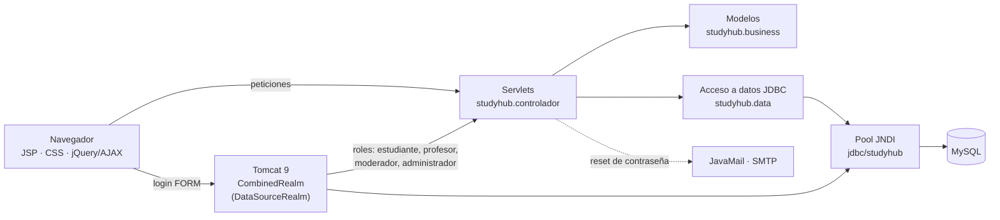

<div align="center">

# StudyHub

**Plataforma web colaborativa donde los estudiantes comparten apuntes y resuelven dudas en foros por asignatura, con roles, votos sin recargar la página y seguridad gestionada por el servidor.**


<sub>Servicios y Sistemas Web (SSW) · Grado en Ingeniería Informática · Universidad de Valladolid · Curso 2023-2024</sub>

</div>



## En pocas palabras

- **Reto:** dar a los estudiantes un sitio común para compartir apuntes y resolver dudas por asignatura, con usuarios, permisos y moderación.
- **Solución:** una aplicación web Java EE con arquitectura MVC sin framework: 25 servlets controladores, 20 vistas JSP, una capa de acceso a datos JDBC por entidad y autenticación delegada en Tomcat contra MySQL.
- **Demuestra:** desarrollo web backend en Java, diseño por capas, seguridad declarativa con roles, modelado de bases de datos relacionales y AJAX en el frontend, en un proyecto de equipo.

## Lo más destacado

- **Seguridad gestionada por el contenedor:** `web.xml` define recursos públicos y privados, autenticación `FORM` y cuatro roles; Tomcat valida las credenciales contra MySQL con un `CombinedRealm` que acepta tanto el nickname como el correo.
- **Permisos por rol en los controladores:** borrar asignaturas o temas está reservado a moderadores y administradores; un comentario o un fichero lo pueden borrar ellos o su propietario (`request.isUserInRole(...)`).
- **Votos sin recargar la página:** los comentarios se votan con *like*/*dislike* y el recuento se actualiza por AJAX.
- **Recuperación de contraseña por correo:** contraseñas almacenadas con hash SHA-256 y tokens de restablecimiento con caducidad (tabla `reset_tokens`), enviados con JavaMail.
- **Gestión de apuntes:** subida por arrastrar y soltar de PDF, JPEG o PNG (hasta 16 MB), guardados en MySQL como `MEDIUMBLOB` y asociados a un foro o a un comentario.
- **Registro con validación asíncrona:** comprobación de nickname y correo duplicados antes de enviar el formulario.

## Competencias

| Área | Qué se aplicó |
| --- | --- |
| Backend Java | Servlets y JSP (Jakarta EE 8), patrón MVC por capas, JDBC |
| Seguridad | Autenticación `FORM`, `DataSourceRealm`, roles, hash SHA-256, tokens con caducidad |
| Bases de datos | Esquema MySQL, pool de conexiones JNDI, almacenamiento de ficheros en BLOB |
| Frontend | HTML5, CSS3 adaptable con *media queries*, JavaScript, jQuery/AJAX, *drag & drop* |
| Herramientas | Maven (WAR), Apache Tomcat, NetBeans, Git en equipo |

## Funcionalidades

- **Registro y autenticación de usuarios.** Alta con comprobación asíncrona de nickname y correo duplicados, inicio de sesión con formulario y restablecimiento de contraseña por correo electrónico.
- **Foros por asignatura.** Cada asignatura (con su curso) tiene su foro, y en cada foro se abren temas para plantear dudas.
- **Preguntas y respuestas.** Los usuarios comentan en los temas y votan los comentarios con *like*/*dislike*.
- **Gestión de apuntes.** Los ficheros se suben arrastrándolos o seleccionándolos. Luego se pueden consultar, descargar, ver en «Mis ficheros» y eliminar.
- **Búsqueda** de asignaturas y de temas.
- **Perfil de usuario** con la actividad reciente y una «posición en el podio» que clasifica a los usuarios por sus aportaciones.

## Arquitectura

- **Modelos** en `studyhub.business` (`User`, `Asignatura`, `Tema`, `Comentario`, `Fichero`, `VotoComentario`...).
- **Acceso a datos** en `studyhub.data`: una clase `*DB` por entidad y un `ConnectionPool` singleton que obtiene el `DataSource` `jdbc/studyhub` declarado en `META-INF/context.xml`.
- **Controladores** en `studyhub.controlador`: servlets para registro, foros, temas, ficheros, votos, búsqueda y perfil.
- **Vistas** JSP con CSS y scripts propios (validación, *drag & drop*, votos).

## Estructura del repositorio

```
StudyHub/
├── pom.xml
└── src/main/
    ├── java/studyhub/
    │   ├── business/      # Modelos: User, Asignatura, Tema, Comentario, Fichero...
    │   ├── controlador/   # Servlets (registro, foros, temas, ficheros, votos...)
    │   ├── data/          # Acceso a datos y ConnectionPool
    │   └── mysql.sql      # Esquema y datos de ejemplo
    ├── resources/META-INF/persistence.xml
    └── webapp/
        ├── *.jsp          # Vistas
        ├── scripts/       # JavaScript (validación, drag & drop, votos)
        ├── styles/        # CSS
        ├── images/
        ├── META-INF/context.xml   # DataSource y Realm de Tomcat
        └── WEB-INF/web.xml        # Seguridad, roles y páginas de error
```

## Requisitos

1. **Java JDK 8 o superior** (el `pom.xml` compila con nivel 1.8)
2. **Apache Tomcat 9**: la aplicación usa el espacio de nombres `javax.*` de Jakarta EE 8, así que no funciona en Tomcat 10 o posterior sin migrarla.
3. **MySQL** y su conector JDBC (`com.mysql.jdbc.Driver`) en el `lib/` de Tomcat, porque no viene en el `pom.xml`
4. **Maven**

## Cómo compilar y ejecutar

<details>
<summary>Pasos de despliegue en Tomcat 9</summary>

1. Crear la base de datos con el esquema y los datos de ejemplo:
   ```bash
   mysql -u root -p < src/main/java/studyhub/mysql.sql
   ```
2. Crear en MySQL el usuario `studyhub` con permisos sobre la base de datos `studyhub`, o cambiar `username`, `password` y `url` en `src/main/webapp/META-INF/context.xml`.
3. Para restablecer contraseñas por correo, poner una cuenta SMTP propia (remitente y clave) en `SendResetMail.java`. Está configurado para `smtp.gmail.com:587`.
4. Empaquetar el WAR:
   ```bash
   mvn package
   ```
5. Desplegar `target/studyhub-1.0.war` en Tomcat 9 (o ejecutarlo desde NetBeans) y abrir la página de inicio (`index.jsp`).

</details>

## Estado y limitaciones

- Los pasos de despliegue se han deducido de los archivos de configuración y no se han ejecutado en la revisión de este README.
- La configuración de base de datos y de correo está en ficheros del código (`context.xml`, `SendResetMail.java`); hay que adaptarla a cada entorno antes de desplegar.
- Requiere Tomcat 9 (espacio de nombres `javax.*`); no funciona en Tomcat 10 o posterior sin migración.

## Autoría

Proyecto en grupo. Commits de Javier García ([JavivuG](https://github.com/JavivuG)), [huglope](https://github.com/huglope), Sergio Herrero ([sergihejo](https://github.com/sergihejo)), dajimen y subse.

---

<div align="center"><sub>Parte de <a href="https://github.com/JavivuG/UVa-Projects">UVa-Projects</a> · Javier García González</sub></div>
